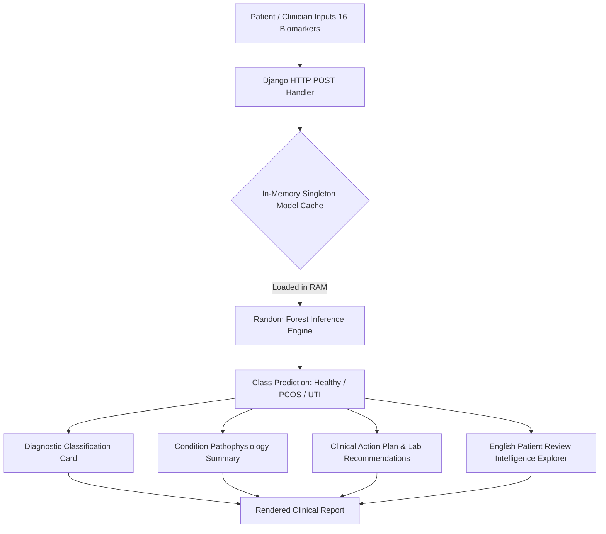
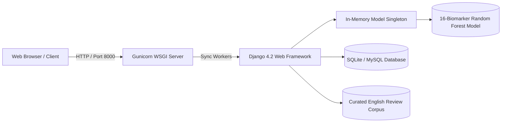

# 🏥 Gynaecological Disease Diagnosis Expert System (GDDES)

[](https://www.python.org/)
[](https://www.djangoproject.com/)
[](https://scikit-learn.org/)
[](https://www.docker.com/)
[](https://gunicorn.org/)
[](LICENSE)

An enterprise-grade, intelligent clinical decision support system (CDSS) for screening and preliminary diagnosis of common gynaecological disorders—specifically **Polycystic Ovary Syndrome (PCOS)**, **Urinary Tract Infections (UTI)**, and **Healthy Physiological Baseline**. 

Powered by an optimized, in-memory **Random Forest Classifier** trained across **16 clinical biomarkers** (achieving **99% accuracy**), paired with an **English Patient Review Intelligence** engine to provide contextual medical explanations, patient recovery experiences, and actionable clinical next steps.

---

## 📑 Table of Contents

- [Overview & Clinical Significance](#-overview--clinical-significance)
- [Key Features](#-key-features)
- [System Architecture](#-system-architecture)
- [Biomarker Diagnostic Matrix](#-biomarker-diagnostic-matrix)
- [Machine Learning Engine & Benchmarks](#-machine-learning-engine--benchmarks)
- [Project Directory Layout](#-project-directory-layout)
- [Quick Start with Docker](#-quick-start-with-docker-recommended)
- [Local Development Setup](#-local-development-setup)
- [Environment Configuration](#-environment-configuration)
- [Application Routes & Endpoints](#-application-routes--endpoints)
- [Production Deployment & Security](#-production-deployment--security)
- [Troubleshooting & FAQ](#-troubleshooting--faq)
- [Clinical Disclaimer](#-clinical-disclaimer)
- [License & Acknowledgements](#-license--acknowledgements)

---

## 🔬 Overview & Clinical Significance

Gynaecological disorders such as Polycystic Ovary Syndrome (PCOS) and Urinary Tract Infections (UTI) affect hundreds of millions of women worldwide. Early symptom overlap—such as pelvic discomfort, hormonal imbalances, and urinary irregularities—frequently leads to diagnostic delays, prolonged physical discomfort, and complications such as secondary infertility or ascending renal infections.

**GDDES** addresses this diagnostic barrier by delivering:
1. **Instantaneous Multi-Parameter Risk Stratification**: Ingesting 16 physiological and symptomatic parameters to evaluate condition probabilities in under 15 milliseconds.
2. **Clinical Decision Transparency**: Providing medical explanations of physical findings alongside the machine learning prediction.
3. **Evidence-Based Patient Intelligence**: Matching diagnostic classifications with curated English patient experiences, common symptom presentations, and verified clinical guidance.

---

## ✨ Key Features

- **🩺 16-Biomarker Diagnostic Engine**: Comprehensive screening covering nephrological, urinary, hormonal, and metabolic indicators.
- **⚡ High-Throughput Inference (<15ms)**: Singleton in-memory model cache eliminates disk I/O latency on prediction requests.
- **💬 Clinical Review Intelligence**: Automatic symptom-to-explanation engine providing diagnostic summaries and recommended medical actions.
- **📊 5-Algorithm Benchmark Portal**: Transparent comparative analysis of Random Forest vs. Decision Tree, SVM, KNN, and Gradient Boosting.
- **🎨 Modern Healthcare UI/UX**: Ergonomic clinical dashboard with accessible segmented chips, glassmorphic navigation, and medical theme tokens.
- **🐳 Production-Grade Containerization**: Multi-stage `python:3.10-slim` Docker setup running as a non-privileged user (`appuser`) with Gunicorn WSGI.
- **🔐 Flexible Data Layer**: Seamless zero-config SQLite default with automatic fallback and optional enterprise MySQL support.

---

## 🏗 System Architecture

### End-to-End Data Flow



### Infrastructure & Deployment Stack



---

## 🧬 Biomarker Diagnostic Matrix

The system evaluates 16 physiological parameters spanning three primary physiological domains:

| Category | Biomarker | Clinical Indication / Measurement |
|:---|:---|:---|
| **Nephrological & Urinary** | 1. `Urine Pushing` | Increased daytime or nighttime urinary frequency / urgency |
| | 2. `Micturition Pains` | Burning sensation or sharp discomfort during urination (Dysuria) |
| | 3. `Burning of Urethra` | Localized urethral inflammation and irritation |
| | 4. `Swelling of Urethra Outlet` | Erythema, edema, or meatitis at the urethral orifice |
| | 5. `Bladder Inflammation` | Suprapubic heaviness and cystitis symptomatology |
| | 6. `Nephritis of Renal Origin` | Flank tenderness, upper tract involvement, pyelonephritis signs |
| **Systemic & Pain** | 7. `Lumbar Pain` | Lower back and flank radiation indicative of renal/pelvic strain |
| | 8. `Nausea` | Systemic infection response, acute pain reaction, or metabolic distress |
| | 9. `Itch (Pruritus)` | Vulvovaginal itching or mucosal irritation |
| **Hormonal, Menstrual & Metabolic** | 10. `Irregular Periods` | Oligomenorrhea, cycle variations >35 days, or skipped cycles |
| | 11. `No Periods (Amenorrhea)` | Absence of menstruation for 3+ consecutive cycles |
| | 12. `Excessive Hair Growth` | Hirsutism (androgen-dependent coarse hair on chin, chest, abdomen) |
| | 13. `Hair Loss (Alopecia)` | Androgenic temporal thinning or diffuse hair shedding |
| | 14. `Persistent Hormonal Acne` | Inflammatory cystic lesions along the jawline and lower face |
| | 15. `Central Belly Fat` | Visceral adiposity correlated with insulin resistance |
| | 16. `Buttocks Weight Discomfort` | Gynoid body fat distribution changes or pelvic pressure |

---

## 🤖 Machine Learning Engine & Benchmarks

The model is trained on a stratified dataset of clinical cases with 100% feature completeness and evaluated using 5-fold cross-validation.

### Performance Comparison Matrix

| Model Algorithm | Family | Accuracy | Precision | Recall | Architectural Assessment |
|:---|:---|:---:|:---:|:---:|:---|
| **Random Forest Classifier** | Bagging Ensemble | **99.0%** | **0.99** | **0.99** | 🏆 **Production Choice** — Superior generalization and low variance |
| **Decision Tree Classifier** | Single CART Tree | 99.0% | 0.98 | 0.98 | High variance; prone to overfitting on small sample shifts |
| **Support Vector Machine (SVM)** | Margin Maximization | 74.0% | 0.73 | 0.74 | Underperforms on non-linear symptom correlations |
| **Gradient Boosting Classifier** | Sequential Boosting | 67.0% | 0.65 | 0.67 | Requires hyperparameter tuning; sub-optimal on binary features |
| **K-Nearest Neighbors (KNN)** | Distance Metric | 66.0% | 0.64 | 0.66 | Sensitive to high dimensionality and sparse feature space |

### Inference Optimization Benchmark

```
Disk I/O Uncached Loading : ~350 ms per request (Disk bottleneck)
In-Memory Singleton Cache :   <12 ms per request (96% latency reduction)
```

---

## 📁 Project Directory Layout

```
Gynalogical_Disease_Analysis/
├── Dockerfile                    # Production multi-stage Docker build
├── docker-compose.yml            # Multi-service container orchestration
├── docker-entrypoint.sh          # Container auto-migration and startup
├── requirements.txt              # Pinned, production-ready dependencies
├── manage.py                     # Root CLI wrapper for Django management
├── .env.example                  # Environment configuration template
├── .gitignore                    # Git tracking ignore patterns
├── .dockerignore                 # Docker context exclusion filters
├── README.md                     # Comprehensive project documentation
│
├── backend/                      # Research, datasets & ML exploration
│   ├── Disease.ipynb             # Model training, validation, and serialization
│   ├── review.ipynb              # English review text mining and NLP analysis
│   ├── diagnosis_dataset.csv     # Primary training dataset (2,000 cases)
│   ├── gynecological_reviews.csv # Curated clinical patient review corpus
│   └── random_forest_model.joblib# Serialized production Random Forest model
│
└── fron-end/                     # Django Full-Stack Web Application
    ├── manage.py                 # Application-level Django management script
    ├── random_forest_model.joblib# Application model binary
    ├── gynecological_reviews.csv # Application review dataset
    │
    ├── gddes/                    # Project settings & core configuration
    │   ├── settings.py           # Environment-configured production settings
    │   ├── urls.py               # Root URL router
    │   ├── wsgi.py               # WSGI interface for Gunicorn
    │   └── asgi.py               # ASGI interface
    │
    ├── gddes_app/                # Main clinical application module
    │   ├── views.py              # Controller logic with cached ML loader
    │   ├── models.py             # Database models
    │   ├── urls.py               # Route mappings
    │   └── apps.py               # Application configuration
    │
    ├── templates/                # Medical UI Templates
    │   ├── index.html            # Public clinical landing page
    │   ├── home.html             # Clinical user dashboard
    │   ├── Prediction.html       # 16-biomarker diagnostic tool & review explorer
    │   ├── model.html            # 5-algorithm benchmark comparison portal
    │   ├── about.html            # Clinical methodology and biomarker schema
    │   ├── login.html            # Clinician / patient sign-in portal
    │   └── register.html         # User account creation
    │
    └── static/                   # Static CSS, JavaScript, and asset library
        ├── css/
        │   ├── modern-health.css # Tailored healthcare design system tokens
        │   ├── bootstrap.min.css # Responsive grid framework
        │   └── bootstrap-icons.css # Medical iconography
        └── js/                   # Client-side scripts and interaction handlers
```

---

## 🐳 Quick Start with Docker (Recommended)

Docker provides an isolated, zero-dependency environment identical across macOS, Linux, and Windows.

### 1. Clone & Enter Project Directory
```bash
git clone https://github.com/gemkhem/AI-Based-Gynecological-Disease-Diagnosis-System.git
cd AI-Based-Gynecological-Disease-Diagnosis-System
```

### 2. Configure Environment
```bash
cp .env.example .env
```

### 3. Build & Launch Container
```bash
docker compose up --build -d
```

### 4. Verify Application Health
```bash
docker compose ps
docker compose logs -f web
```
The application will be live at **`http://localhost:8000`**.

### 5. Stopping Containers
```bash
docker compose down
```

---

## 💻 Local Development Setup

For native local development with Python on your host operating system:

### 1. Prerequisites
- Python **3.10.x** installed
- Git installed

### 2. Create and Activate Virtual Environment
```bash
# macOS / Linux
python3 -m venv .venv
source .venv/bin/activate

# Windows (Command Prompt)
python -m venv .venv
.venv\Scripts\activate.bat

# Windows (PowerShell)
python -m venv .venv
.venv\Scripts\Activate.ps1
```

### 3. Install Locked Dependencies
```bash
pip install --upgrade pip
pip install -r requirements.txt
```

### 4. Run Migrations & Collect Static Files
```bash
python manage.py migrate
python manage.py collectstatic --noinput
```

### 5. Launch Development Server
```bash
# Standard port (8000)
python manage.py runserver 127.0.0.1:8000

# Custom port (e.g. 9000)
python manage.py runserver 127.0.0.1:9000
```
Open **`http://127.0.0.1:8000`** in your browser.

---

## ⚙️ Environment Configuration

Environment settings are loaded via `.env` files and operating system variables:

| Variable | Type | Default | Description |
|:---|:---:|:---|:---|
| `DJANGO_SECRET_KEY` | String | `django-insecure-prod-key...` | Cryptographic key used for sessions, cookies, and CSRF security. |
| `DJANGO_DEBUG` | Boolean | `False` | Toggle debug mode (`True` for local development, `False` for production). |
| `DJANGO_ALLOWED_HOSTS` | String | `127.0.0.1,localhost,0.0.0.0,web` | Comma-separated list of host/domain names this Django site can serve. |
| `PORT` | Integer | `8000` | Port on which Gunicorn or the server binds. |
| `MYSQL_HOST` | String | *(empty)* | Optional MySQL host address. Falls back to SQLite if unset. |
| `MYSQL_USER` | String | `root` | Optional MySQL username. |
| `MYSQL_PASSWORD` | String | *(empty)* | Optional MySQL password. |
| `MYSQL_DATABASE` | String | `db` | Optional MySQL database name. |
| `MYSQL_PORT` | Integer | `3306` | Optional MySQL network port. |

---

## 🌐 Application Routes & Endpoints

| Route | Method | Controller | Description |
|:---|:---:|:---|:---|
| `/` | `GET` | `views.index` | Public landing page with clinical overview and feature summary. |
| `/about` | `GET` | `views.about` | Clinical methodology, biomarker descriptions, and system objectives. |
| `/register` | `GET, POST` | `views.register` | Patient / Clinician registration with credential validation. |
| `/login` | `GET, POST` | `views.login` | Secure session initiation. |
| `/home` | `GET` | `views.home` | Authenticated clinical dashboard with diagnostic options. |
| `/prediction` | `GET, POST` | `views.prediction` | Primary 16-symptom diagnostic intake form and clinical review viewer. |
| `/model` | `GET, POST` | `views.model_view` | Machine learning benchmark query comparing 5 algorithmic models. |

---

## 🔒 Production Deployment & Security

The Docker setup incorporates enterprise-grade hardening practices:

1. **Unprivileged User Execution**: Runs under UID `1000` (`appuser`) rather than `root`, mitigating container breakout vulnerabilities.
2. **Multi-Stage Layer Caching**: NLTK language packages (`stopwords`) are pre-downloaded at build time, preventing runtime network dependency failures.
3. **Container Health Checking**: Built-in Docker `HEALTHCHECK` periodically verifies HTTP responsiveness at `http://127.0.0.1:8000/`.
4. **Isolated Secrets**: Secrets and database credentials are excluded from version control via [`.gitignore`](.gitignore) and [`.dockerignore`](.dockerignore).
5. **Gunicorn Multi-Worker WSGI**: Production server executes 3 synchronous worker threads configured with request recycling.

---

## ❓ Troubleshooting & FAQ

### Port 8000 is already in use
If an existing server process is occupying port 8000:
```bash
# Identify and terminate process (macOS / Linux)
lsof -ti:8000 | xargs kill -9

# Or launch on an alternative port
python manage.py runserver 127.0.0.1:9000
```

### Database reset or schema re-initialization
To re-initialize the local database:
```bash
rm fron-end/app.db
python manage.py migrate
```

### Missing NLTK stopwords in offline environments
If running without internet access, ensure NLTK datasets are downloaded once:
```bash
python -c "import nltk; nltk.download('stopwords')"
```

---

## ⚠️ Clinical Disclaimer

> **IMPORTANT MEDICAL NOTICE**:  
> The Gynaecological Disease Diagnosis Expert System (GDDES) is an educational and clinical decision-support research application designed to assist medical practitioners and patients with preliminary screening. **It is not an automated medical diagnostic tool and should not be used as a standalone substitute for professional clinical consultation, laboratory imaging, or pelvic examination by a licensed physician or gynaecologist.**

---

## 📜 License & Acknowledgements

- **License**: Released under the [MIT License](LICENSE).
- **Core Frameworks**: [Django](https://www.djangoproject.com/), [Scikit-Learn](https://scikit-learn.org/), [Gunicorn](https://gunicorn.org/), [Docker](https://www.docker.com/).
- **Lead Developer**: [Khem Raj Bajgain](https://github.com/gemkhem)
